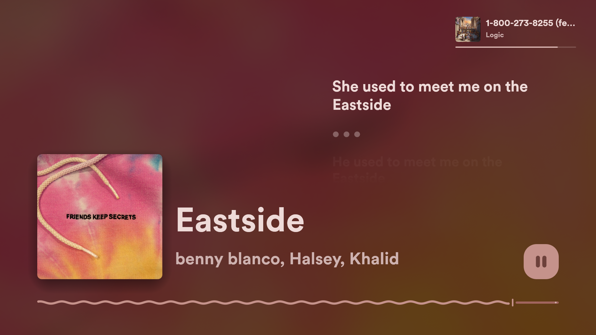
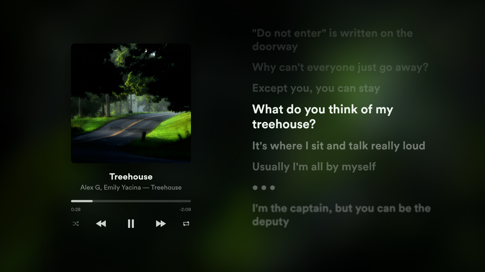
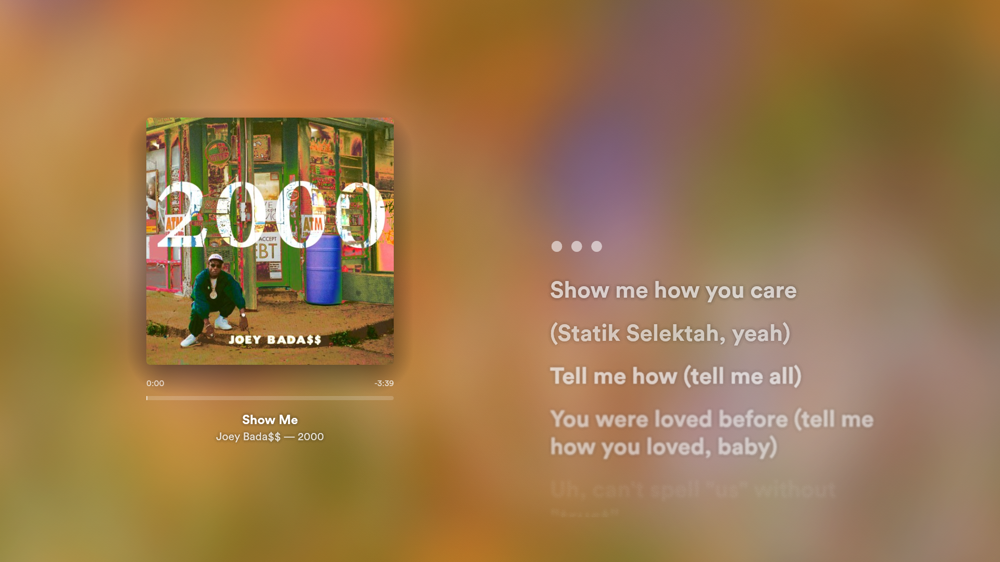
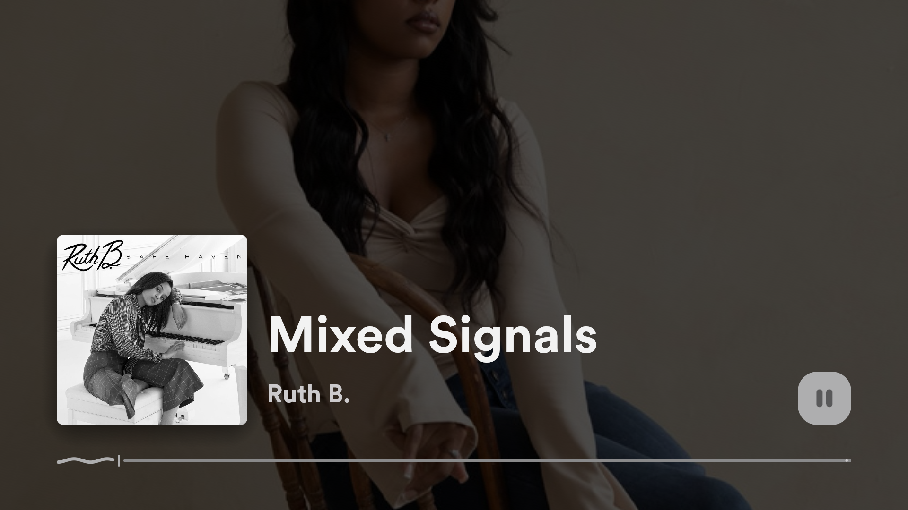
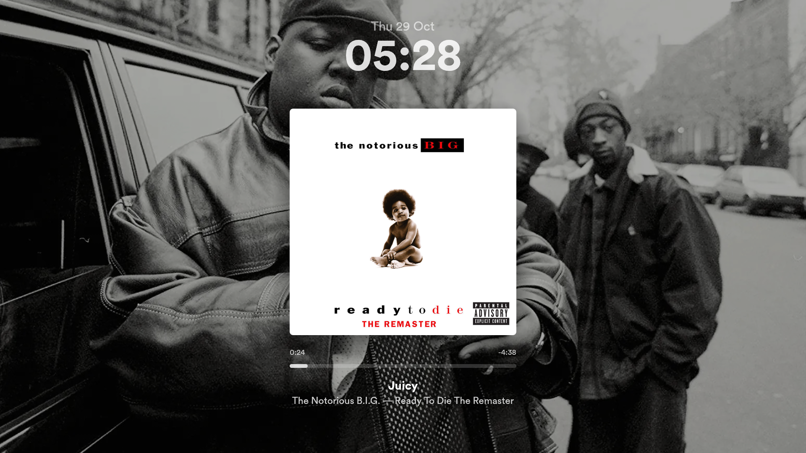
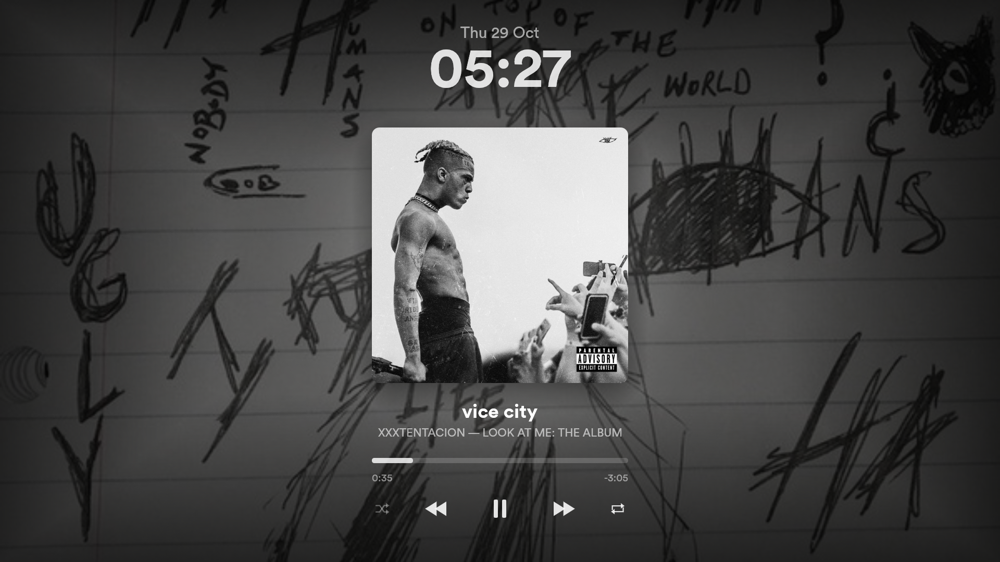

# Encore

Encore is a fullscreen now-playing display for Linux. It follows [MPD](https://www.musicpd.org) or any MPRIS player (Spotify, Firefox, VLC, mpv, Rhythmbox...) and shows the current song with its album art, colours drawn from the cover or the artist image behind it, time-synced lyrics and three layouts, plus a lyrics manager and lyric clip export. It displays and controls playback (play/pause, seek, previous/next); it is not a full player or MPD client.

## Screenshots
| Encore Classic                                                                                       | Classic                                                                                               | Vibrant                                                                          |
| ---------------------------------------------------------------------------------------------------- | ----------------------------------------------------------------------------------------------------- | -------------------------------------------------------------------------------- |
|      |                                          |                     |
|  |  |  |

## Features
- Three [layouts](docs/layouts.md): Encore Classic, Classic and Vibrant, with a moving album-art backdrop and an "Up next" card
- [Album colours](docs/layouts.md#album-colours) for text, icons and bars, drawn from the cover, or from the artist image when it is the background
- A switchable [display font](docs/layouts.md#display-font) for titles, lyrics and the clock: the bundled Figtree, any installed font or a font file
- Time-synced [lyrics](docs/lyrics.md) from local files, a cache, LRCLIB or KuGou
- A [lyrics manager](docs/lyrics.md#lyrics-manager) for searching, importing, editing and re-timing lyrics, with a tap-to-sync view
- [Lyric clip export](docs/export.md) as share-ready MP4s in 16:9, 9:16 and 1:1
- [Artist background images](docs/artist-backgrounds.md) from a local folder, TheAudioDB or Deezer
- Works with [MPD or any MPRIS player](docs/players.md), switching between them as they come and go and reconnecting automatically
- Native Wayland and X11 windows that rescale to any size
- [Configuration file and environment variables](docs/configuration.md)

## Installation

### Linux Mint, Ubuntu and Debian
1. Download the `.deb` file (`encore_<version>_amd64.deb`) from the [latest release](https://github.com/Baguma03/encore/releases/latest).
2. Double-click the downloaded file to open it in the package installer, then click **Install**.
3. Start Encore from the applications menu.

MPRIS players such as Spotify, Firefox and VLC work with no further setup. MPD users also install `mpc` (`sudo apt install mpc`), which fetches MPD's album art. To remove Encore, uninstall the `encore` package from the package manager, or run `sudo apt remove encore`.

### Other distributions
Download `encore-<version>-x86_64-linux.tar.gz` from the [latest release](https://github.com/Baguma03/encore/releases/latest), unpack it and run the install script:
```
tar -xzf encore-<version>-x86_64-linux.tar.gz
cd encore-<version>-x86_64-linux
./install.sh
```
The script installs the binary to `~/.local/bin/encore` and a desktop entry to `~/.local/share/applications/encore.desktop`, without root access. `./install.sh --uninstall` removes both. Each release also lists a `SHA256SUMS` file for checking the downloads (`sha256sum -c --ignore-missing SHA256SUMS`).

An AUR package is planned.

### Requirements
- Linux, on Wayland or X11, with a GPU driver that provides Vulkan or OpenGL (rendering uses wgpu).
- For the prebuilt `.deb` and tarball: x86_64 and glibc 2.35 or newer (Ubuntu 22.04, Linux Mint 21, Debian 12 or newer).
- A playback source: an MPD server, or any MPRIS-capable player. MPRIS needs a D-Bus session bus, which desktop sessions provide. MPD needs `mpc`, which fetches its album art.
- Rust and `cargo`, only to build from source. [rustup](https://rustup.rs) installs them.
- Optionally `ffmpeg` with libx264 and aac, for [exporting lyric clips](docs/export.md).

| Distribution  | MPD and `mpc` (MPD only)           | `ffmpeg` (optional)                                                            |
| ------------- | ---------------------------------- | ------------------------------------------------------------------------------ |
| Arch          | `sudo pacman -S mpd mpc`           | `sudo pacman -S ffmpeg`                                                        |
| Debian/Ubuntu | `sudo apt install mpd mpc`         | `sudo apt install ffmpeg`                                                      |
| Fedora        | `sudo dnf install mpd mpc`         | `sudo dnf install ffmpeg` (from RPM Fusion, which provides the full codec set) |
| openSUSE      | `sudo zypper install mpd mpclient` | `sudo zypper install ffmpeg` (from Packman, which provides the full codec set) |

MPD itself is configured in [Players](docs/players.md#setting-up-mpd).

### Build from source
```
git clone https://github.com/Baguma03/encore
cd encore
cargo build --release
```
The binary is `target/release/encore`. Artist background images are downloaded automatically; images added by hand go in `~/.local/share/encore/artists/` (see [Artist backgrounds](docs/artist-backgrounds.md)). Local lyric files go in `~/.local/share/encore/lyrics/` (see [Lyrics](docs/lyrics.md)). To install the binary, run:
```
cargo install --path .
```

### Install with cargo
```
cargo install --git https://github.com/Baguma03/encore
```
The binary lands in `~/.cargo/bin`, which must be on `PATH`.

### Desktop entry
The `.deb` package and `install.sh` install a desktop entry. For a build from source or `cargo install`, install the desktop entry from the repository to start Encore from a desktop launcher such as GNOME's, KDE's or Cinnamon's:
```
install -Dm644 encore.desktop ~/.local/share/applications/encore.desktop
```
The entry runs `encore`, so `~/.cargo/bin` must be on `PATH` (as it is after `cargo install` with a standard Rust setup).

The window's class (app id) is `encore`, for use in compositor window rules.

## Quick start
1. Start MPD (see [Players](docs/players.md#setting-up-mpd)) or any MPRIS player.
2. Run `encore`.

Encore starts fullscreen. `Esc` or `q` quits, `f` toggles fullscreen and `?` shows the keyboard shortcuts.

## Keyboard shortcuts
| Key                                   | Action                                                                                                 |
| ------------------------------------- | ------------------------------------------------------------------------------------------------------ |
| `f` / `F11`                           | Toggle fullscreen                                                                                      |
| `c`                                   | Toggle cursor visibility                                                                               |
| `d`                                   | Toggle debug window                                                                                    |
| `Space` (or click)                    | Play/pause                                                                                             |
| `←` / `→`                             | Seek 5 seconds back / forward within the song                                                          |
| `<` / `>` (`Shift`+`,` / `Shift`+`.`) | Previous / next track (`,` and `.` alone do nothing)                                                   |
| `l`                                   | Cycle layouts (Encore Classic → Classic → Vibrant)                                                     |
| `h`                                   | Cycle layouts backwards (Encore Classic → Vibrant → Classic)                                           |
| `y`                                   | Toggle lyrics                                                                                          |
| `Shift`+`y`                           | Open/close the [lyrics manager](docs/lyrics.md#lyrics-manager)                                         |
| `t`                                   | Toggle date/clock overlay                                                                              |
| `b`                                   | Toggle the moving backdrop                                                                             |
| `a`                                   | Toggle the artist background for the current layout                                                    |
| `k`                                   | Toggle album colours                                                                                   |
| `u` / `Shift`+`u`                     | Cycle the [display font](docs/layouts.md#display-font) forwards / backwards through `display_fonts`    |
| `s`                                   | Toggle the previous/next buttons beside the Encore Classic layout's progress bar                       |
| `j`                                   | Cycle the Encore Classic layout's lyric alignment (left → centre → right → right column, left-aligned) |
| `o`                                   | Cycle the Encore Classic layout's lyric flow (classic → stacked → scrolling)                           |
| `e`                                   | Open/close the [lyric clip export panel](docs/export.md#the-panel)                                     |
| `[` / `]`                             | Mark the clip in-point / out-point at the current playback position                                    |
| `?`                                   | Show/hide the keyboard shortcuts overlay                                                               |
| `Esc` / `q`                           | Quit (`Esc` closes the shortcuts overlay first when it is open; `q` always quits)                      |

### Keyboard shortcuts overlay
`?` opens a "Keyboard shortcuts" cheatsheet over a dimmed backdrop: a dark card with the keys grouped into Playback, Lyrics, Display, Export and App across three columns, each key drawn as an outlined monospace key cap beside its description, with alternative keys separated by a `/` and the keys of a combination joined by a `+`. Press `?` again, press `Esc`, click the × in the card's corner, or click outside the card to close it; the click does not toggle play/pause. Other keys keep working while it is open. While the export panel or the lyrics manager is open, `?` does nothing.

## Documentation
- [Layouts and appearance](docs/layouts.md): the three layouts, album colours, up next, moving backdrop and backgrounds
- [Configuration](docs/configuration.md): the configuration file and environment variables
- [Players](docs/players.md): MPD setup, MPRIS players, choosing a source and player, album art
- [Lyrics](docs/lyrics.md): lyric sources, online lookup, the lyrics manager and the sync view
- [Exporting lyric clips](docs/export.md): formats, the export panel, quality and output
- [Artist backgrounds](docs/artist-backgrounds.md): artist images and artist name parsing
- [Releasing](docs/releasing.md): building and publishing the `.deb` and tarball release packages

## Contributing
Issues and pull requests are welcome.

## Licence
MIT — see [LICENSE](LICENSE). The bundled [Figtree](https://github.com/erikdkennedy/figtree) and [Lexend Deca](https://github.com/googlefonts/lexend) fonts are licensed under the SIL Open Font License 1.1 — see [assets/font/OFL-Figtree.txt](assets/font/OFL-Figtree.txt) and [assets/font/OFL-LexendDeca.txt](assets/font/OFL-LexendDeca.txt).

## Credits
Encore began as a fork of mpd-display-rs by Allison Linhart, original repository has since been taken down.

Built with [eframe/egui](https://crates.io/crates/eframe), the [mpd](https://crates.io/crates/mpd) crate and [zbus](https://crates.io/crates/zbus). Online lyrics come from [LRCLIB](https://lrclib.net) and KuGou, and artist images from [TheAudioDB](https://www.theaudiodb.com) and [Deezer](https://www.deezer.com). The now playing display is set in [Figtree](https://github.com/erikdkennedy/figtree) by Erik Kennedy ([licence](assets/font/OFL-Figtree.txt)) unless another display font is chosen, and the interface in [Lexend Deca](https://github.com/googlefonts/lexend) by the Lexend Project ([licence](assets/font/OFL-LexendDeca.txt)), both under the SIL Open Font License 1.1.
