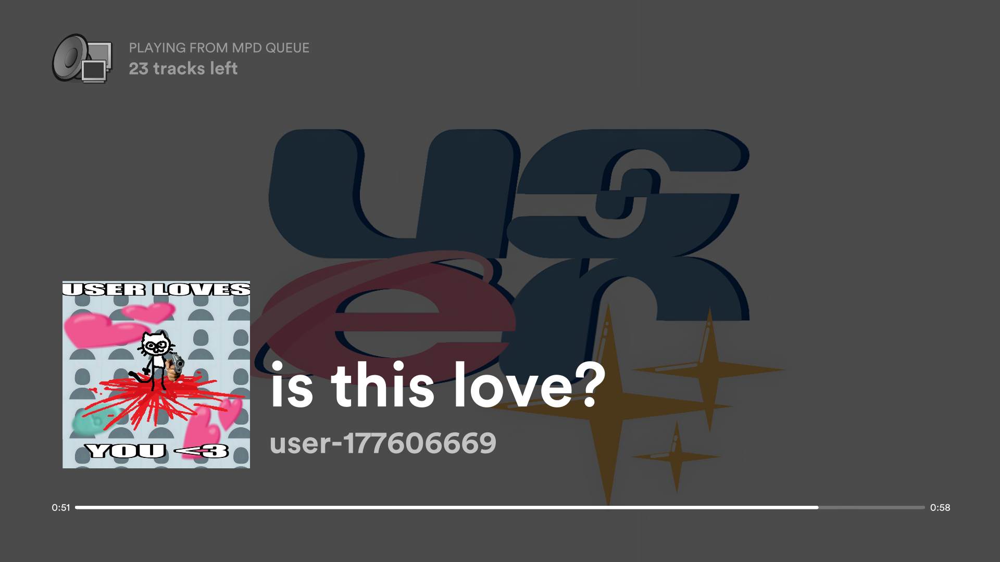
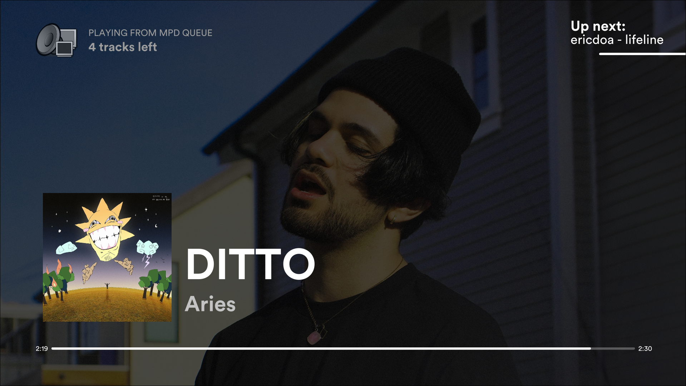
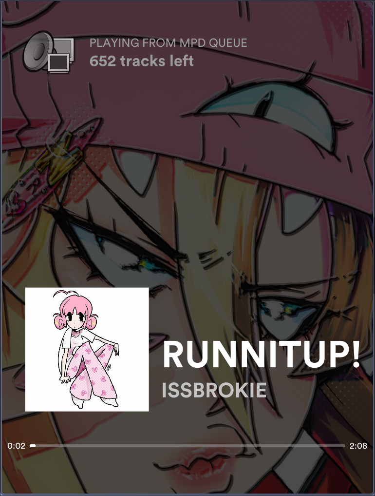
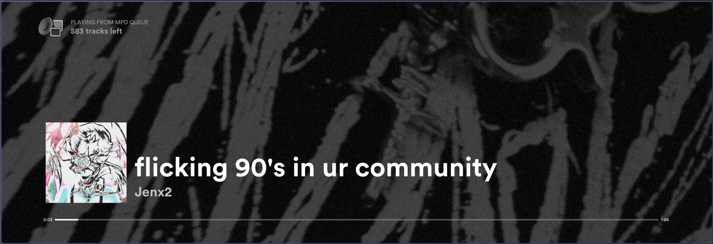
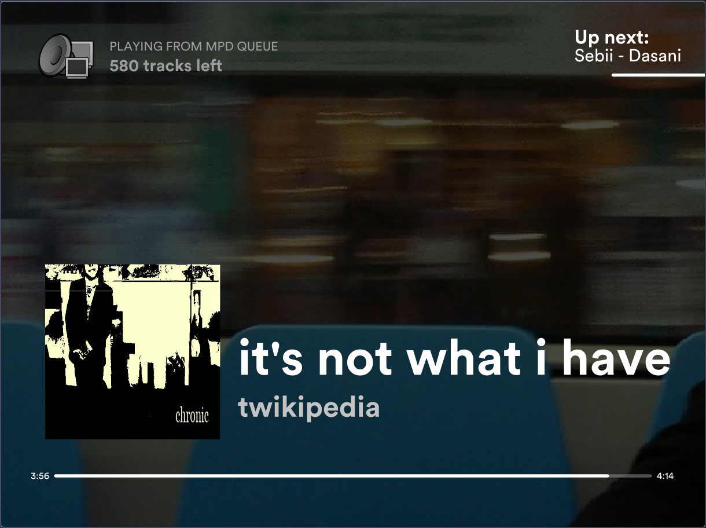
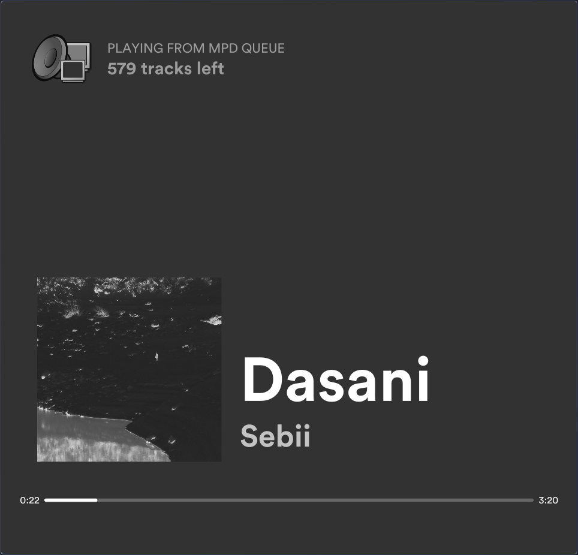
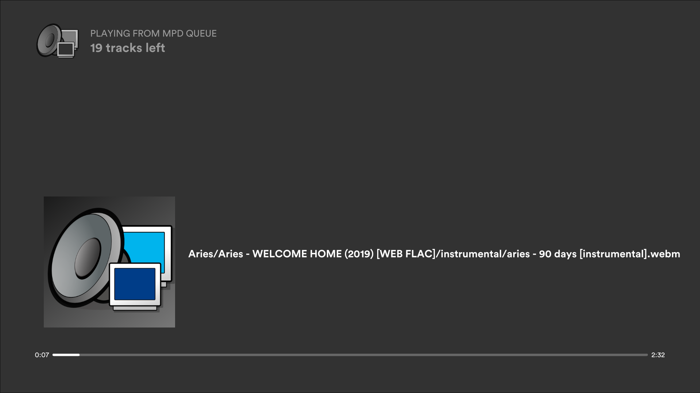
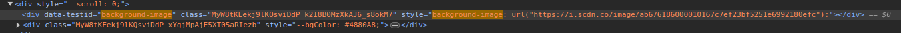

# mpd-display-rs: A Spotify/Apple Music-like graphical display for MPD

Note that this is not a full MPD client, as it only *displays* data (plus basic playback controls).

This is a replacement for my old [mpd-display](https://github.com/allylikesu/mpd-display), which was coded in Python using the Pygame engine. It was coded in one night, and I am not very proud of it.

### Improvements from python version
- Faster start-up
- Much lighter-weight, using Rust with [eframe/egui](https://crates.io/crates/eframe)
- Runs natively on both Wayland and X11
- Smooth updating progress bar
- Doesn't spam mpc commands every frame (Uses the [mpd](https://crates.io/crates/mpd) crate for updating status, gets album art on song change using `mpc readpicture`)
- Reconnects automatically if MPD goes away or restarts
- Time-synced lyrics
- Many more. The amount of sins that were committed in that old version still keep me up at night.

Only tested on Linux. Requires MPC (used to fetch album art). `ffmpeg` (with libx264 and aac) is optional and only needed for [exporting lyric clips](#exporting-lyric-clips).

## Layouts
Three layouts are available. `l` cycles through them at runtime (Apple → Vibrant → Spotify), and `MPD_DISPLAY_LAYOUT` chooses the starting one.

- **Apple Music-style** (default): a blurred album art backdrop, rounded album art with the title, "Artist — Album" and a progress bar below it, clickable previous/play-pause/next buttons, a seekable progress bar, and a time-synced lyrics column on the right. The active lyric line is highlighted, the column scrolls smoothly, and lines far from the active one fade out. An optional date/clock overlay can be toggled with `t`.
- **Vibrant**: modelled on Apple Music's colourful lyrics view. The backdrop is bright: enlarged, heavily blurred copies of the album art with a faint gradient of its main colours over them, cross-fading between songs. Light covers stay light; a soft dark halo behind the text, and a mild wash on very light art, keep white text readable. Square album art sits on the left with the elapsed and remaining time, a thin seekable progress bar, and the title and "Artist — Album" centred beneath it, and the time-synced lyrics are on the right. There are no transport buttons; clicking anywhere toggles play/pause. Tall and square windows stack the art above the lyrics. The `t` clock overlay works here too.
- **Spotify-style**: modelled on the Spotify desktop client's fullscreen mode, with the artist's background image (see [below](#obtaining-and-using-artist-background-images-from-spotify)). The album art, with rounded corners and a soft shadow, sits on the left with the large title and artist beside it. A rounded-square play/pause button, styled after the Quickshell (illogical-impulse) media widget, sits at the far right with its bottom level with the art's. Along the bottom of the screen a thin seekable wavy progress bar runs from the left edge of the art to the right edge of the button: the elapsed part is a sine wave that moves while playing and flattens when paused, followed by a vertical bar handle and the flat remaining track; click or drag it to seek. The play and pause icons are the filled, rounded Material Symbols, drawn as vector shapes. Clicking anywhere else toggles play/pause. Text, the bar and the button take a subtle tint from the cover (see [Colours](#spotify-colours)). Time-synced lyrics show as three lines in the upper part of the screen, centred over the space right of the art: the previous line faint, the active line bold and bright, and the next line faint below it. On each new line they scroll up smoothly, the outgoing line fading out at the top and the incoming one fading in at the bottom; long lines wrap. `• • •` stands for the time before the first line and for instrumental gaps. Unsynced lyrics advance through the song at an even pace. For the last 10% of a song, a glass "Up next" card slides into the top-right corner with the next song's cover, title and artist, and a thin bar counting down the rest of the current song. While the card shows, the lyrics move down to clear it. The `t` clock sits in the same corner while the card is hidden.
- **Moving backdrop**: enlarged, blurred copies of the album art drift across the screen, turn, swell and blend into each other, like Apple Music's animated artwork. It keeps moving while playback is paused. Toggle it with `b`, or start without it with `MPD_DISPLAY_MOTION=off`; with it off, the backdrop is still.
- **Backgrounds**: `a` toggles the artist background for the current layout. When it is on and `artists/` has an image for the song's artist, the layout uses that image: tinted dark in the Spotify and Apple layouts with a vignette in the Apple one, and lighter in the Vibrant layout, with a halo behind the text. With motion on, the image slowly pans and zooms. When it is off, or there is no image, each layout uses its own backdrop: blurred album art for Spotify (moving when motion is on, darkened to match), dark blurred art for Apple and the colourful art for Vibrant. The setting is kept per layout for the session; it starts on for Spotify and off for Apple and Vibrant, and `MPD_DISPLAY_ARTIST_BG` sets the starting value for all of them.

### Spotify colours
The Spotify layout takes its colours from the album art. The cover's average colour is blended into a small Material 3 dark scheme (primary, on-primary, secondary container and text colours), the same way the Quickshell media widget adapts its colours. The title, lyrics, clock and Up next card text are near-white with a hint of the art's hue; the artist uses the scheme's muted text colour; the progress bar uses the primary colour for the elapsed part and handle and the secondary container colour for the rest of the track; and the play/pause button is filled with the primary colour while playing and the secondary container colour while paused. Every colour keeps a minimum contrast against a dark backdrop, so light, dark and very saturated covers stay readable, and the colours cross-fade along with the art when the song changes.

## Features
- Toggleable fullscreen with the `f` or `F11` key
- Fully reactive window, all screen elements will be properly scaled/positioned
- Artist-specific background art (See more [here](#obtaining-and-using-artist-background-images-from-spotify))
- Time-synced lyrics from local files, a cache, or [LRCLIB](#lyrics)
- Click or press space to play/pause; `←` / `→` for previous/next track
- Easy to quit with `Esc` or `q`
- Toggle cursor visibility with `c`
- Toggle a useless debug window with `d`
- Export lyric clips as share-ready MP4s (see [below](#exporting-lyric-clips))

### Keys
| Key | Action |
| --- | --- |
| `f` / `F11` | Toggle fullscreen |
| `c` | Toggle cursor visibility |
| `d` | Toggle debug window |
| `Space` (or click) | Play/pause |
| `←` / `→` | Previous / next track |
| `l` | Cycle layouts (Apple → Vibrant → Spotify) |
| `y` | Toggle lyrics |
| `t` | Toggle date/clock overlay |
| `b` | Toggle the moving backdrop |
| `a` | Toggle the artist background for the current layout |
| `e` | Open/close the lyric clip export panel |
| `[` / `]` | Mark the clip in-point / out-point at the current playback position |
| `Esc` / `q` | Quit |

## Screenshots














## Installation/Usage
I'm too lazy to figure out how to make a proper cargo package.

Clone the repo, run `cargo build --release`, then create a startup script to execute the binary in the crate directory:
```
#!/usr/bin/env bash
cd <PATH TO CLONED REPO> || exit 1

target/release/mpd-display-rs
```

### Environment variables
| Variable | Description |
| --- | --- |
| `MPD_HOST` | MPD server host. Defaults to `localhost`. If your server has a password, format it as `pass@ip`. |
| `MPD_PORT` | MPD server port. Defaults to `6600`. |
| `MPD_MUSIC_DIR` | Your MPD music directory. Enables sidecar lyrics files next to the audio files and audio in exported clips. If unset, `music_directory` is read from `$XDG_CONFIG_HOME/mpd/mpd.conf` (`~/.config/mpd/mpd.conf` when unset), `~/.mpdconf`, or `/etc/mpd.conf`, whichever exists first. |
| `MPD_DISPLAY_EXPORT_DIR` | Output folder for exported clips. Defaults to `~/Videos/mpd-display`. |
| `MPD_DISPLAY_LAYOUT` | `apple`, `vibrant` or `spotify`. Defaults to `apple`. |
| `MPD_DISPLAY_LYRICS` | `on` or `off`. Defaults to `on`. |
| `MPD_DISPLAY_MOTION` | `on` or `off`: the moving backdrop. Defaults to `on`. |
| `MPD_DISPLAY_ARTIST_BG` | `on` or `off`: the artist background in every layout. Defaults to on for the Spotify layout and off for the others. |
| `MPD_DISPLAY_LYRICS_ONLINE` | Set to `0`, `off`, `false` or `no` to disable LRCLIB lookups. Enabled by default. |

## Exporting lyric clips
Renders a share-ready MP4 of the Apple, Vibrant or Spotify layout (lyrics, album art, title and progress bar) for a chosen part of the current song. Rendering happens offline in the background on the GPU, faster than real time, while the display keeps running. Requires `ffmpeg` with libx264 and aac.

### Formats
| Format | Resolution |
| --- | --- |
| 16:9 | 1920×1080 |
| 9:16 (default) | 1080×1920 |
| 1:1 | 1080×1080 |

Pick one or several; each becomes its own file. Portrait and square have their own layouts, which are also used when the live window has that shape. The Spotify style renders 16:9 only.

### Style
The panel's **Dark**, **Vibrant** and **Spotify** chips choose the look of the clip: the dark Apple layout over blurred art, the colourful Vibrant layout, or the Spotify layout with its three-line lyrics (and the Up next card when the clip reaches the last 10% of the song). The panel starts on the style of the layout on screen. The **Motion** switch exports the moving backdrop, or a still one when off; it starts at the display's current setting. The **Artist background** switch uses the artist image as the background; it starts at the live setting of the chosen style's layout and is disabled, with a "no artist image" note, when `artists/` has no image for the song's artist.

### Choosing the range
Press `e` to open the export panel.
- Click the first lyric line, then the last (shift-click also works). The start snaps to 0.5 s before the first line, and the end to the start of the line after the last.
- Nudge the start and end in 0.5 s steps in the panel.
- Alternatively, mark while listening: `[` sets the in-point and `]` the out-point, then press `e`.
- A clip can be at most 3 minutes long.
- `Esc` closes the panel.

### Audio
Audio is cut from the song's file in the MPD music directory, with short fades, and can be toggled in the panel. The music directory comes from `MPD_MUSIC_DIR`, else `music_directory` in `$XDG_CONFIG_HOME/mpd/mpd.conf` (`~/.config/mpd/mpd.conf` when unset), `~/.mpdconf`, or `/etc/mpd.conf`. If the file cannot be found, the clip is exported without audio and the toast says so.

### Output
Files are written to `~/Videos/mpd-display/` (override with `MPD_DISPLAY_EXPORT_DIR`) and named `<Artist> - <Title> (1m05-1m35) 9x16.mp4`, with ` (2)`, ` (3)`, ... appended if the name is taken. Exports run one at a time. A toast in the bottom-right corner shows progress, its × cancels the export, and clicking the "Saved" toast opens the folder.

## Lyrics
Lyrics are looked up in this order, and the first hit wins:
1. **Sidecar file** (requires `MPD_MUSIC_DIR`): `<music dir>/<song>.lrc`, or `.txt` for unsynced lyrics, next to the audio file.
2. **Local folder**: `./lyrics/<artist> - <title>.lrc` (or `.txt`). The primary artist and a bare `<title>` are also tried, and names are matched case-insensitively.
3. **Disk cache**: `~/.cache/mpd-display-rs/lyrics/`
4. **[LRCLIB](https://lrclib.net)**: free, no API key needed.

Results from LRCLIB are saved to the disk cache, so lyrics keep working offline afterwards. The next queued song is fetched ahead of time, and songs with no lyrics found are remembered for 7 days before being looked up again.

Synced lyrics use the standard LRC format (`[mm:ss.xx] line`), and the `[offset:+/-ms]` tag is supported. Files without timestamps (and plain-text `.txt` files) are shown as unsynced lyrics.

## Obtaining and using artist background images from Spotify
For Spotify's fullscreen mode, it uses a slightly darkened version of the main artist's profile banner as a background.
If the artist does not have a profile banner, a gradient based on the song's album art is used.

This behaviour is replicated by this program, but the images need to be manually obtained.
If you don't care about Spotify and have your own images you want to use, that is totally cool!
The format of the file should be `<artist name>.jpg` (`.jpeg`, `.png` and `.webp` also work).
The file name should be in **ALL LOWERCASE!**

Obtaining profile banners from Spotify is simple but a little annoying. 
1. navigate to the artist's profile on the Spotify web client. Using Firefox might not work, I had to do this in Chromium.
2. Press `Ctrl+Shift+I` to enter the developer console and inspect the element of the page.
3. Press `Ctrl+F` to open the search prompt. Search for `"background-image:` (Note the quote and colon!). The first result should look like this.

4. Copy the i.scdn.co link. This is the link to the image. Make sure to *NOT* copy the `&quot;` before and after the link.

5. Open this link in your browser. Right click and save it to the `artists/` folder as `<lowercase artist name>.jpg`

### Artist name parsing
In order to display the correct image, this program parses the first artist in the song's artist metadata. There are multiple formats used to separate artist names in this metadata, and improperly parsing this data can cause the program to search for the wrong image file. Current delimeters used are `,_`, `/`, `_&_`, and `;_` (underscores representing spaces). If you encounter issues due to your files using a different format, please open an issue.

## Contributions
If you encounter an issue, open an issue. If you want to contribute... good luck. I'm not too good at rust yet, and this code is rather messy.
