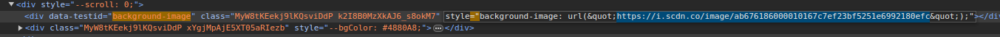

# Artist backgrounds

The layouts can use an image of the song's artist as their background (toggle with `a`; see [Layouts](layouts.md)). Encore reads these images from `~/.local/share/encore/artists/` (`$XDG_DATA_HOME/encore/artists/` when `XDG_DATA_HOME` is set). Encore does not create this folder; create it and add images to it. Without an image for the artist, each layout falls back to its own backdrop.

## File names
Name each file after the artist in all lowercase: `<artist name>.jpg`. The extensions `.jpg`, `.jpeg`, `.png` and `.webp` are recognised.

For example, `~/.local/share/encore/artists/kendrick lamar.jpg` is used for songs by Kendrick Lamar.

## Artist name parsing
Encore looks up the first artist in the song's artist tag. Artists are separated in the tag by `, `, `/`, ` & ` or `; ` (each with the spaces shown); everything from the first separator on is ignored, and the remaining name is lowercased and trimmed. For example, `Quality Control; Lil Baby` looks for `quality control.jpg`.

If your files separate artists with another delimiter, please open an issue.

## Spotify-style banners
Spotify's fullscreen mode uses a slightly darkened version of the main artist's profile banner as its background, and a gradient based on the album art when the artist has no banner. Encore reproduces this, but the images have to be collected by hand. Any image can be used; the steps below fetch a Spotify profile banner:

1. Open the artist's profile in the Spotify web client. A Chromium-based browser is more reliable for this than Firefox.
2. Press `Ctrl`+`Shift`+`I` to open the developer tools and inspect the page.
3. Press `Ctrl`+`F` to open the search field and search for `"background-image:` (note the quote and colon). The first result looks like this:

   

4. Copy the `i.scdn.co` link, which is the image's address, without the `&quot;` before and after it:

   

5. Open the link in the browser, then save the image to the artists folder as `<lowercase artist name>.jpg`.
